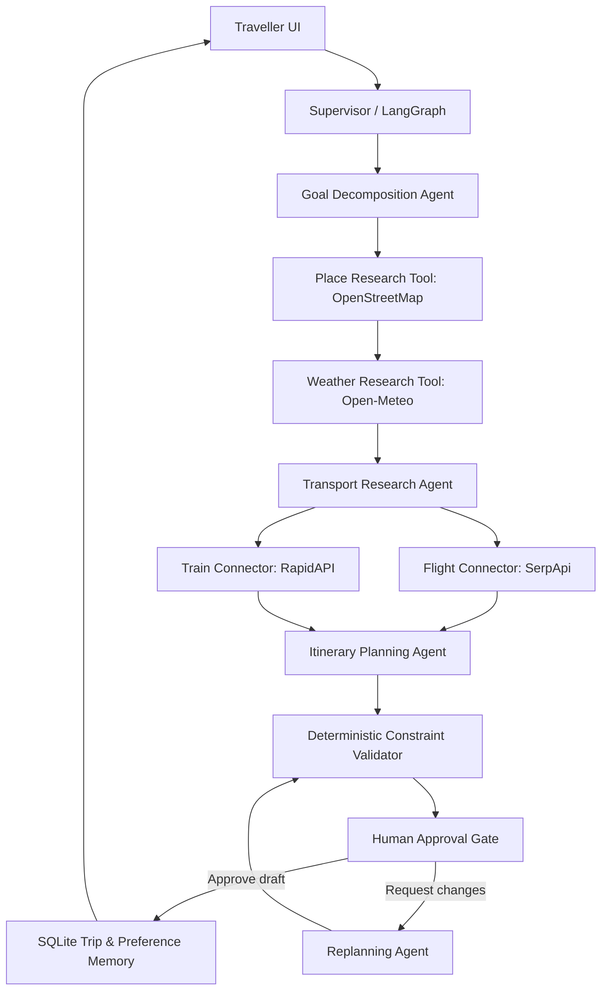

# System architecture

## High-level data flow

The graph currently executes goal decomposition, place research, weather research, transport research, itinerary planning, validation and the approval gate in a clear sequential state graph. The UI exposes the human decision. Replanning is initiated explicitly by the user and is revalidated before it is shown as an updated draft.

## Agent responsibilities

| Agent / node | Responsibility | Guardrail |
|---|---|---|
| Supervisor Agent | Starts and coordinates the workflow | Only calls explicit tools; no unrestricted shell access |
| Goal Decomposition Agent | Turns user request into planning subtasks | Uses structured request fields |
| Travel Research Agent | Calls place query | Named places originate from returned mapped data |
| Weather Research Agent | Fetches forecast for trip dates | Weather can be unavailable outside the forecast horizon |
| Transport Research Agent | Invokes flight or rail route API | Does not purchase, reserve or claim seat inventory |
| Itinerary Planning Agent | Schedules known places; optional Gemini scheduling | Rejects model-invented place names |
| Constraint Validation Agent | Checks day count, place provenance, times and cost vs. budget | Deterministic validation is authoritative |
| Human Approval Gate | Marks draft awaiting explicit user action | Every revision requires approval again |
| Replanning Agent | Revises activity order/choices based on feedback | Validates result and returns to pending approval |

## Data integrations

- **SerpApi Google Flights:** dynamic flight search results and comparison links. Fare freshness depends on returned source response and can change before checkout.
- **RapidAPI railway provider:** direct train routes, schedules and optional indicative route fares. The chosen connector does not check seat inventory or book.
- **Open-Meteo:** geocoding and model forecast. The public forecast has a finite horizon.
- **OpenStreetMap Overpass:** mapped attractions, museums, viewpoints, historic places and parks. Data does not guarantee opening, closure, price or suitability.
- **Gemini API (optional):** can help schedule the verified attractions and revise a schedule. The rule-based path works without a key.

## Memory and state

SQLite stores a small single-user preference profile, saved itinerary drafts/status and agent event log in `data/voyagewise.sqlite3`. That folder is ignored by Git. Streamlit session state carries the current screen's draft and provider results. This is appropriate for a local academic prototype; a multi-user deployment would need authenticated users, managed secrets, deployment-specific persistence and access controls.

## Constraint handling

Food, accommodation and local transport estimates are derived from figures explicitly entered by the user. If the transport provider returns a price, it can be included. Unknown attraction ticket prices are excluded and disclosed. The hard budget comparison is computed in Python; the LLM cannot override it. An over-budget itinerary receives a validation issue and stays unapproved.

## Failure handling

Connectors use timeouts, validate required input, check HTTP results, and return descriptive messages. A missing/invalid external provider cannot be treated as evidence of no trains/flights. Provider absence and a successful search returning zero results are separate states. When place research fails, itinerary drafting uses a generic flexible activity rather than inventing a place name.
